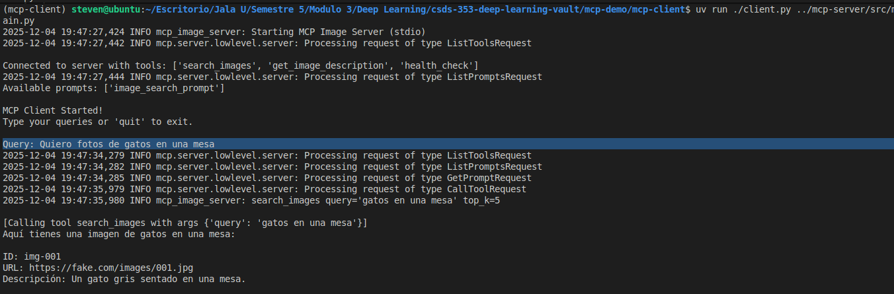
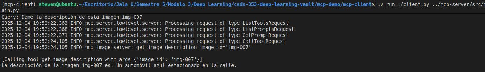
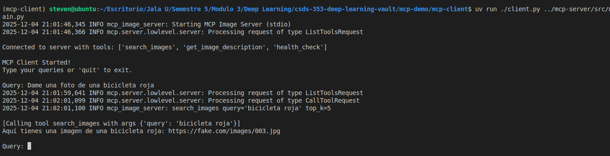
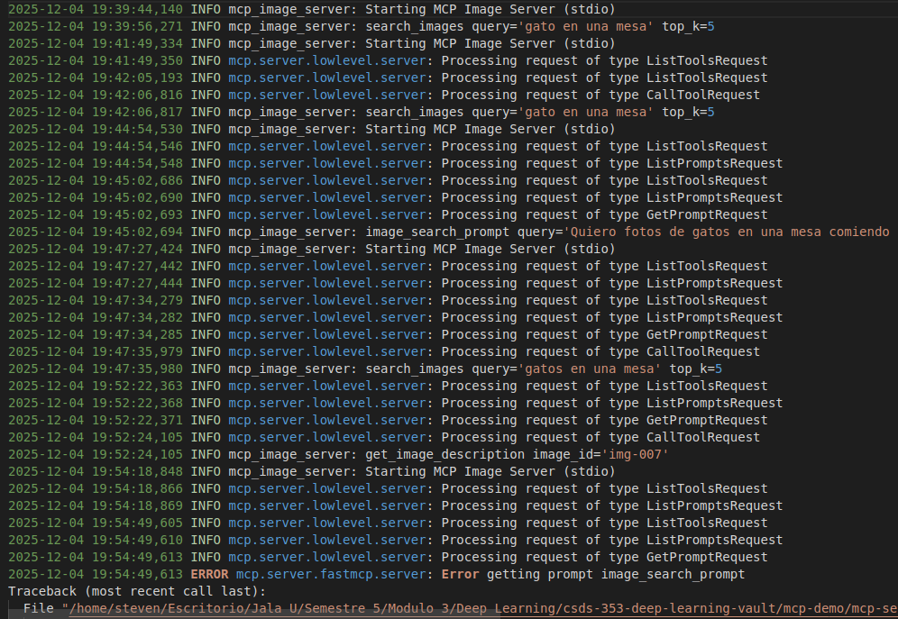
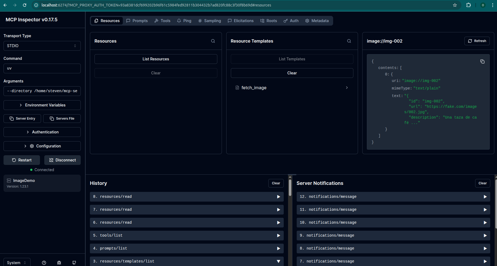
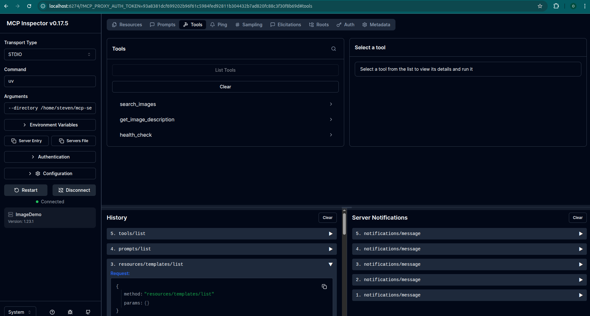

# MCP Demo — Setup & Installation Guide

This project uses **uv**, a fast Python package and environment manager.
You must install **uv** before setting up the MCP client or server.

## Install `uv`

`uv` is required to create virtual environments and run Python modules.

**Installation instructions:**
[https://docs.astral.sh/uv/#highlights](https://docs.astral.sh/uv/#highlights)

## Client Setup

```bash
cd mcp-demo/mcp-client

# Create virtual environment
uv venv

# Activate the environment
source .venv/bin/activate

# Install required packages in editable mode
pip install -e . # or 'uv sync'
```

## Server Setup

```bash
cd mcp-demo/mcp-server

# Create virtual environment
uv venv

# Activate the environment
source .venv/bin/activate

# Install required packages in editable mode
pip install -e . # or 'uv sync'
```

Create a `.env` file:

```bash
echo "GOOGLE_API_KEY=your-api-key" > .env
```

## Running the Client

From the root of the mcp client run:

```bash
uv run ./client.py ../mcp-server/src/main.py
```

This launches the MCP client and automatically spawns the server through stdio.

# Results

### Queries

 
 


### Logs

 

### Resources

 

### Tools

 

### Prompts


# Observations

Personally, I really enjoyed this exercise. I feel like you can do a ton of things with an MCP server — that’s where its flexibility really shows, because you can load it with as many tools as you want, and the client can use them for different tasks as needed.

At the beginning, I didn’t fully understand the idea of a server and a client, since I was used to working with REST APIs. The way it finally made sense to me was by thinking of the client as a mechanic and the server as a toolbox. Depending on the job, the mechanic just grabs whatever tool he needs from the box.

In that sense, it’s not hard at all for the client to know what tools the server offers. And when it comes to potential use cases, I can easily see MCP being used to connect several external or even local tools to improve different processes, or even to automate everyday tasks.

# References

- https://docs.astral.sh/uv
https://modelcontextprotocol.io/docs/develop/build-server
https://modelcontextprotocol.io/docs/develop/build-client
https://github.com/modelcontextprotocol/python-sdk
https://www.youtube.com/watch?v=Y4bpWRLdRoA